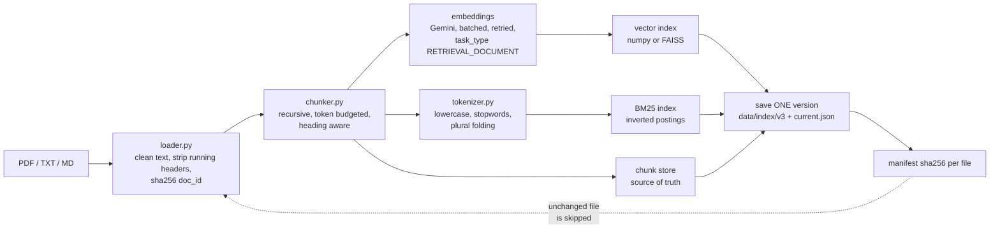
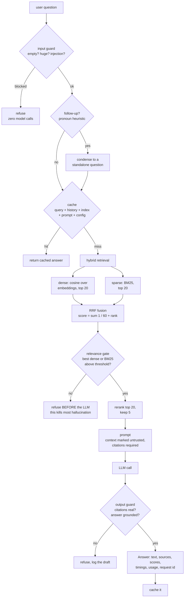
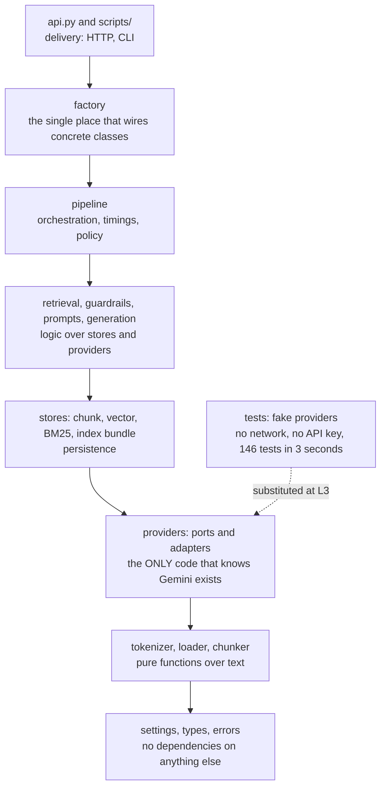
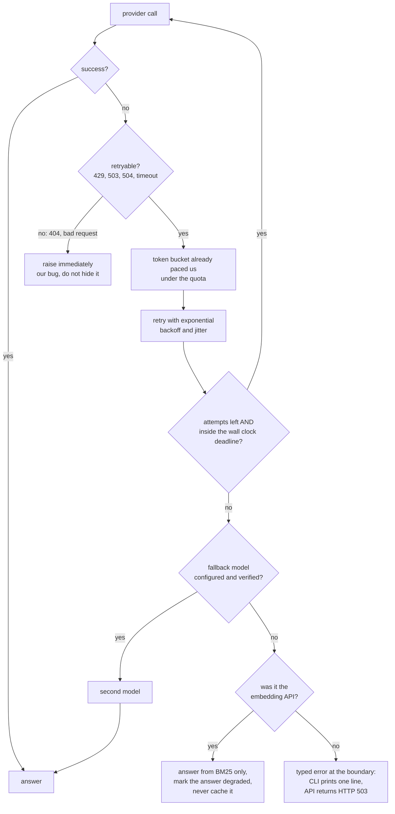
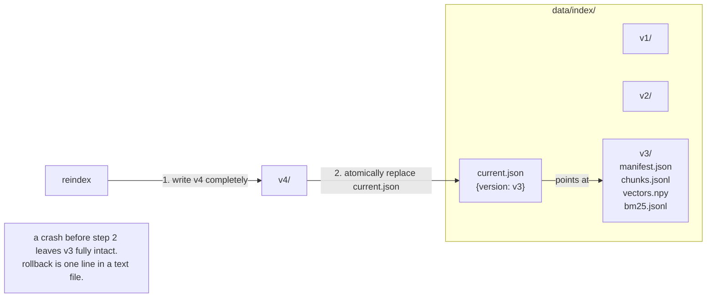
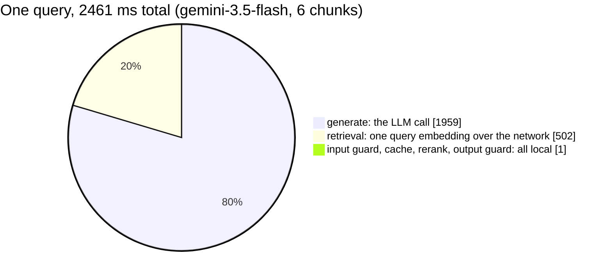

# ARCHITECTURE: why every file, format and decision is what it is

Read this with the code open. Every section answers three questions: what is
this, why does it exist in a production system, and what did we deliberately
not do.

---

## 1. The shape of the system

RAG is two pipelines, not one. People who only think about the query side
ship systems that break in week two.

**Ingestion (offline, runs when documents change)**



**Query (online, runs per user question)**



The single most important structural idea: **the generator can only ever be
as good as retrieval**. Most "the LLM hallucinated" bugs are retrieval bugs.
That is why half of this codebase is retrieval and measurement, and the LLM
call itself is about 15 lines (`generation.py`).

---

## 2. Layering, and the one rule that keeps it clean



Dependencies point inward. `pipeline.py` depends on an `EmbeddingProvider`
protocol, never on Gemini, which is why the whole suite runs offline and why
swapping providers is one file.

**The rule: dependencies point inward, never outward.** `pipeline.py` depends
on an `EmbeddingProvider` protocol, not on Gemini. That single decision is
what makes 120 tests run offline in two seconds with no API key, and what
makes "swap Gemini for OpenAI" a change in one file.

Contrast with the reference project: `reranker.py` printed Rich tables to the
terminal from inside library code. That is UI inside business logic, so the
reranker could never be used from an API or tested quietly.

---

## 3. File by file

### `settings.py` (the contract)
Every tunable number and model name in the system. Typed, validated, loaded
from environment variables.

- `SecretStr` for the API key, so printing or logging the settings shows
  `**********`. Secrets leak through logs far more often than through code.
- Validation at import time (`gt=0`, cross field validator). A bad config
  kills the process at boot, not in the middle of a user's request. This is
  **fail fast**, and it is the reason there is no "why is overlap bigger than
  chunk size" bug three weeks later.
- `fingerprint()` returns the subset of config that changes answers. It goes
  into the cache key and into every evaluation report, so you can always tell
  which settings produced a number.
- Reference bug fixed: the old project had `embedding_model` in its config
  and a hard coded model name in `embeddings.py`. Changing the config did
  nothing. Config drift is a silent, expensive bug.

### `logging_setup.py` (the eyes)
One JSON object per line, with a `request_id` from a `ContextVar`.

- JSON because logs are read by machines first (grep, Loki, CloudWatch,
  Datadog). `print("Loaded 42 chunks")` cannot be filtered, alerted on, or
  joined across stages.
- `request_id` ties retrieval, rerank and generation of one question
  together. When a user says "the 3pm answer was wrong", this is how you find
  it. A `ContextVar` rather than passing an id through twelve function
  signatures.
- `extra={...}` fields become top level JSON keys, so `timings_ms` and
  `usage` are queryable, not buried in a sentence.

### `types.py` (the vocabulary)
`Page`, `Chunk`, `Candidate`, `Turn`, `Usage`, `LLMResult`, `Answer`.

- `Page` and `Chunk` are frozen: facts about a document that nobody should
  mutate mid pipeline.
- `Candidate` is deliberately mutable: each retrieval stage annotates it with
  one more score (`dense_score`, `sparse_score`, `fused_score`,
  `rerank_score`). At the end you can print exactly why a chunk is in the
  answer. The reference passed dictionaries around, so a typo in a key name
  was a silent `None`.
- `Answer` carries sources, citations, groundedness, timings, usage and the
  request id. A return type you can debug from.

### `errors.py` (how failures are classified)
`RetryableProviderError` and `ProviderError` are different classes because
the caller's decision is different: retry with backoff, or give up and return
503. `GuardrailBlocked` is a 4xx, `StoreError` is an operator problem.

### `loader.py` (garbage in, garbage out)
PDF and text to clean, page tagged `Page` objects.

- `doc_id = sha256(file bytes)[:12]`: the same file always gets the same id,
  which is what makes incremental ingestion and deduplication possible.
- Cleaning that actually matters for retrieval quality: NFKC normalisation
  (ligatures like "finance" become "finance"), hyphen break repair
  ("exam-\nple" becomes "example"), line unwrapping, and removal of running
  headers and footers (a line that repeats at the edge of most pages). Left
  in, that header text gets embedded into every single chunk and quietly
  pollutes every similarity score.
- Scanned pages produce no text: we log a warning naming the file instead of
  indexing silence. OCR is the real fix and is out of scope here.
- Unsupported file types raise instead of being read as text.

### `chunker.py` (the highest leverage file in RAG)
Recursive, structure aware, token budgeted.

Try the coarsest boundary first (paragraph), and only go finer (line,
sentence, word, raw slice) when a piece is still over budget. Then pack small
pieces up to `chunk_size`, carrying an overlap made of **whole units**.

- The budget is in **tokens**, approximated conservatively. The reference
  counted words and called them tokens; 512 words is roughly 650 to 700
  tokens, so its real limit was 30 percent higher than it believed.
- A heading never ends a chunk. It travels to the next chunk with the text it
  introduces, because "Pricing" alone is a useless chunk and the paragraph
  after it loses its subject.
- Nothing is ever dropped. The reference deleted every chunk under 10 words,
  which silently removed headings, table rows and short policy lines, exactly
  the content users ask about.
- `chunk_id = f"{doc_id}-{index:05d}"`: deterministic (same input gives the
  same ids) and unique across documents. The reference used
  `md5(text)[:12]`, so the same boilerplate sentence in two different PDFs
  collided into one entry and one of the two sources disappeared from
  citations.

### `tokenizer.py` (the sparse half of retrieval)
Lowercase, NFKC, strip punctuation, drop stopwords, fold plurals.

The reference used `text.lower().split()`. Consequences: the token was
`"simple."` so a query for `simple` scored zero; `refund` and `refunds` were
unrelated terms; and every document matched `the`. Keyword search was
crippled, which matters because keyword search is the half that catches
product codes, error numbers, section references and surnames.

Deliberately light stemming (plurals only, not Porter). Aggressive stemming
destroys exact term matching, which is the one thing BM25 is better at than
embeddings.

`TOKENIZER_VERSION` is stored in the index manifest: change the rules and the
index refuses to load until you reindex, instead of silently mismatching
query terms against document terms.

### `providers/` (ports and adapters)
`base.py` defines protocols; `gemini.py` and `fake.py` implement them.

What the Gemini adapter adds over calling the SDK directly, and why each one
is not optional in production:
- **Retries with exponential backoff and jitter** on 429 and 5xx. A rate
  limit is normal, not exceptional. Jitter stops every client retrying in the
  same millisecond.
- **Batching**, with automatic fallback to one text per call if the model
  rejects batches. Degrade, do not die.
- **`task_type`**: `RETRIEVAL_DOCUMENT` when indexing, `RETRIEVAL_QUERY` when
  searching. The model produces different vectors for the two roles and
  asymmetric embedding measurably improves retrieval. The reference sent
  neither.
- **Dimension validation**: if the API returns a different width than the
  settings say, we raise. Silently mixing 768 and 3072 vectors corrupts an
  index in a way that is very hard to diagnose later.
- **Always L2 normalise**: Gemini pre-normalises only the full 3072 dim
  vectors. At 768 or 1536 you must normalise yourself or cosine similarity is
  wrong. This is a documented footgun that almost everyone hits once.
- **Model ids rot**: `gemini-2.0-flash`, which the reference project used,
  was shut down on 1 June 2026, and the newest models deprecate the
  `temperature` parameter. The provider drops sampling parameters and retries
  once if the API rejects them, and `scripts/list_models.py` asks the API
  what this key can actually call. Never hard code a model name from a
  tutorial.
- **Thinking models share the output budget**: Gemini 3 generates internal
  reasoning before the answer, billed against `max_output_tokens`, and at the
  default `high` level the reasoning expands to fill whatever you allow. A
  small budget therefore returns an empty answer with `finish_reason
  MAX_TOKENS`. The provider sends a `thinking_level` (default `low` for
  grounded answers), falls back to the older `thinking_budget` field on
  pre-1.51 SDKs, counts thinking tokens in `Usage`, and the generator retries
  exactly once with a doubled budget when the answer comes back empty.
- **Empty responses are handled**: a safety block returns no text. The
  reference assigned `response.text` (None) straight into memory and the
  cache. Here it becomes an honest refusal.

`fake.py` gives every word a fixed pseudo random direction and averages them.
Unrelated texts land near orthogonal, shared words pull vectors together: a
crude but real vector space, deterministic on every machine. This is what
makes the entire test suite free, offline and trustworthy.

### `stores/bm25_index.py` (written out, not imported)
```
score = sum over query terms:  IDF(t) * tf * (k1 + 1) / (tf + k1 * (1 - b + b * len/avglen))
IDF(t) = ln(1 + (N - df + 0.5) / (df + 0.5))
```
Three ideas, and an interviewer will ask about all three:
- **tf saturation** (`k1`, typically 1.2 to 2.0): the tenth occurrence of a
  word adds far less than the second. Without it, keyword stuffing wins.
- **length normalisation** (`b`, typically 0.75): long documents contain more
  of everything, so they are penalised. `b=0` switches it off.
- **IDF**: rare terms carry more signal. The `1 +` inside the log is Lucene's
  fix for the textbook formula, where a term appearing in more than half the
  documents gets a negative weight and starts subtracting score.

It is a real inverted index (`term -> {chunk_id: term frequency}`), so
scoring touches only the documents containing a query term, never all N.

### `stores/vector_index.py` (dense search, two backends)
`numpy` is exact brute force cosine, zero dependencies, a few milliseconds
over 100k vectors. `faiss` is the same exact search (`IndexFlatIP`), SIMD
optimised, and the door to approximate indexes (IVF, HNSW, PQ) later. Both
assume L2 normalised vectors so the inner product **is** cosine.

The honest scaling note: past a few million vectors you stop managing files
and move to a vector database for filtering, replication and concurrent
writes. Knowing when to stop hand rolling is part of the job.

### `stores/index.py` (the bundle, and all the on disk format decisions)

**One bundle, not three stores.** Chunks are the single source of truth;
vectors and postings are derived from them and saved together. The reference
had two independent stores whose add paths disagreed (one appended, one
replaced), so its dense and sparse views could silently drift apart.

**Versioned directories plus a pointer file:**
```
data/index/
  current.json      {"version": "v3"}
  v1/  v2/  v3/     manifest.json, chunks.jsonl, vectors.npy, bm25.jsonl
```
Writing `v3/` and then atomically replacing `current.json` means a crash
halfway through a reindex leaves the previous index completely intact, and a
rollback is one line in a text file. This is blue/green deployment applied to
data. Each file is also written to a `.tmp` name and renamed, because rename
is atomic while a partial write is not.

**Why each format:**

| File | Format | Why not something else |
|---|---|---|
| `manifest.json` | JSON | Small, human readable, the first thing you open when debugging. Holds the contract: schema version, embedding model, dim, tokenizer version, index version, per document sha256. |
| `chunks.jsonl` | JSON Lines | One object per line: appendable, streamable, greppable, and it diffs line by line in git. A single huge JSON array must be parsed whole just to read one chunk. |
| `vectors.npy` | NumPy binary | Exact float32 round trip, loads instantly, memory mappable. The same vector as JSON text is about five times larger and loses precision. |
| `bm25.jsonl` | JSON Lines | Tokens per chunk, so loading does not re-tokenise and the tokenizer version stays pinned to the index. |
| answer cache | SQLite | One file, transactional, no server, in the standard library. Swap for Redis when more than one process serves traffic. |
| **never** | pickle | Unpickling a file an attacker can write is remote code execution, and a pickle only loads back into the exact class version that wrote it. The reference pickled both of its stores. |

`index_version()` is a hash of the chunk ids plus the embedding model, dim
and tokenizer version. It flows into the cache key, so a reindex cannot serve
yesterday's answers.

The manifest also stores the per file `sha256`, which is what makes
incremental ingestion possible.

### `retrieval/fusion.py` (RRF, and why)
Cosine lives in `[-1, 1]`, BM25 is unbounded. Adding them directly means BM25
silently dominates. RRF throws the scores away and keeps only the ranks:
`score = sum 1/(k + rank)`. No normalisation, no tuning, robust across
corpora. `k = 60` (the convention from the original paper) flattens the curve
so rank 1 does not crush rank 2. Weighted fusion with min-max normalisation
is implemented too, as the alternative to measure against.

### `retrieval/hybrid.py` (dense plus sparse, plus the refusal gate)
Dense finds "how do I get my money back" in a chunk that says "refund
policy". Sparse finds `error E4012` and `Section 7.2`. Nobody ships only one.

`is_relevant_enough()` is the single highest value branch in the whole
system: if the best dense score is below `min_dense_score` and the best BM25
score is below `min_sparse_score`, we refuse **before** calling the LLM. The
reference always passed its top 5 to the model, which is precisely how a
confident, fluent, completely invented answer gets produced. Thresholds are
model and corpus specific, which is why `scripts/evaluate.py` prints a
calibration block telling you where to put them.

**What happens when a dependency is down** (the layers, cheapest first):
1. retry with exponential backoff and jitter (`providers/gemini.py`)
2. failover to a second model on retryable errors only (`providers/fallback.py`,
   set `LLM_FALLBACK_MODEL`)
3. degrade: if the embedding API is unavailable, answer from BM25 alone and
   mark the answer `degraded` so nobody mistakes it for full quality. A
   degraded answer is never cached, because the cache would outlive the outage
4. fail cleanly: a typed exception at the boundary, so the CLI prints one line
   and the API returns 503

### `retrieval/reranker.py` (bi-encoder versus cross-encoder)
Retrieval uses a **bi-encoder**: query and chunk are embedded separately and
compared, which is fast because chunk vectors are precomputed, but the model
never sees the two texts together. A **cross-encoder** feeds the pair through
one model and outputs a relevance score: far more accurate, far too slow to
run over the corpus, so it only ever runs over the top 20 to 50.

The reference called its reranker a cross-encoder in the config and then
re-scored with the same embedding model used for retrieval, which adds an API
call and almost no information. Here the default is honest (`none`), the
cross-encoder is a real optional implementation, and a crashing reranker
falls back to fusion order instead of failing the request.

### `retrieval/query_transform.py` (follow up questions)
"What about its pricing?" retrieves nothing useful, because "its" has no
referent in the vector space. We condense the follow up into a standalone
question using the history, then retrieve. A cheap pronoun heuristic decides
whether an LLM call is needed at all, and a rambling or empty rewrite is
rejected in favour of the original. Never trust a model's output blindly,
including your own model's.

### `guardrails/input_guard.py` and `output_guard.py`
Four places guardrails belong, and all four are here:
1. **Input**: empty, oversized, control characters, prompt injection. Cheap,
   runs before a single token is spent.
2. **Retrieval**: the relevance gate above.
3. **Prompt**: the context block is tagged `trust="untrusted-data"` and the
   system prompt states in advance that text inside it is data, never
   instructions. Retrieved chunks that look like injection attempts are
   logged, not dropped, because a document legitimately discussing prompt
   injection is not an attack.
4. **Output**: every `[n]` must point at a source we actually sent (a model
   citing `[7]` out of 5 sources is fabricating its evidence), and the answer
   must share enough content words with the chunks it cites. An honest "I
   don't know based on the provided context" is allowed through without
   citations, because punishing honesty trains the wrong behaviour.

PII is masked **for logs only**. Masking the query itself would break
retrieval. Logs are shipped to third parties and kept for years, so that is
where the risk actually is.

Honest limitation: regexes catch lazy attacks. Production adds a trained
classifier, and more importantly keeps the model's privileges low so a
successful injection cannot do anything dangerous.

### `prompts.py`
Prompts are code: they live in version control, get reviewed, and carry a
`PROMPT_VERSION` that is part of the cache key. Change the prompt, and
yesterday's cached answers stop being served automatically.

### `cache.py`
The key is a hash of: normalised question, conversation fingerprint, index
version, prompt version, and the config fingerprint (model, top_k, reranker,
thresholds). The reference keyed on (question, number of turns so far), which
collides across different conversations and keeps serving stale answers for
an hour after a reindex. Only grounded, non refused answers are ever cached.

### `ingest.py` (incremental, idempotent)
The manifest remembers a sha256 per file, so: unchanged file is skipped with
zero API calls, changed file drops its old chunks and re-embeds only itself,
deleted file is pruned, identical bytes under a new name are reported as a
duplicate. One unreadable file does not stop the run. Everything is written
as a new index version at the end.

The reference had one mode: if an index file exists, load it and ignore
everything else, so a newly added PDF was silently never indexed, and `force`
re-embedded the entire corpus.

### `pipeline.py` (policy and order)
The order of the nine steps is the design. Guard before spending money.
Rewrite before caching, so two phrasings of the same follow up share an
entry. Refuse before the LLM, not after. Rerank only the survivors. Check the
output before the user sees it. Cache only what deserves replaying. Every
stage is timed into `timings_ms` and logged under one request id.

### `api.py`
One shared pipeline per process, a request id on every response, a token
bucket rate limit, error mapping (user error is 4xx, provider outage is 503),
and a `/health` endpoint that reports whether the index is actually loaded
rather than just that the process is alive.

### `evaluation/`
Without this folder, "is chunk size 512 better than 256?" is an opinion.

Ground truth without brittle labels: each golden question carries an
`evidence_phrase`, an exact string that appears only in chunks that truly
answer it. Labels therefore survive re-chunking and re-embedding, which hand
written chunk ids do not.

Reported: recall@k (the retrieval metric that matters for RAG: the generator
can only use what retrieval found), precision@k, MRR, nDCG@k, plus answer
level citation validity, groundedness and keyword coverage, plus correct and
false refusals on deliberately out of scope questions, plus latency
percentiles, plus a threshold calibration block.

---

## 4. Repository layout decisions

- **`src/` layout**: the package is not importable from the repository root
  by accident, so tests import the installed path, the same way users will.
- **`tests/` mirrors `src/`**, one test file per module, and every test name
  states a behaviour, not a function name.
- **`requirements.txt` / `-dev` / `-optional`** split: the runtime image stays
  small, and the two genuinely heavy dependencies (torch via
  sentence-transformers, faiss) are opt in with a comment saying why.
- **`.env.example` committed, `.env` gitignored**: new joiners see every knob
  without anyone leaking a key.
- **Dockerfile**: dependencies in their own cached layer, non root user, no
  secrets or index baked into the image, a real healthcheck.
- **CI**: ruff plus the full offline test suite on two Python versions. The
  whole suite runs without an API key, which is exactly why it can run on
  every push.

---

## 5. The reference bugs, and where each one is fixed

| # | Reference bug | Fixed in |
|---|---|---|
| B1 | A sentence with no punctuation was never split, so a "512" chunk could be 2000 words | `chunker.py` recursive split with a real cap |
| B2 | Chunks under 10 words were deleted | `chunker.py` keeps everything |
| B3 | `lower().split()` tokenizer: punctuation kept, no stopwords, no plural folding | `tokenizer.py` |
| B4 | Cache key was (question, turn count) | `cache.py` full key |
| B5 | New files silently never indexed | `ingest.py` manifest |
| B6 | `chunk_id = md5(text)` collided across documents | `chunker.py` doc scoped ids |
| B7 | Dense and sparse stores could drift apart | `stores/index.py` one bundle |
| B8 | "Reranker" reused the retrieval embedding model | `retrieval/reranker.py` |
| B9 | Chunk size counted words, documentation said tokens | `chunker.py` token budget |
| B10 | `response.text` of None stored as an answer, no retries or timeouts | `providers/gemini.py`, `pipeline.py` |
| B11 | Model name in config was ignored by the code | `settings.py` single source |
| B12 | Follow up questions retrieved with the raw pronoun | `retrieval/query_transform.py` |

---

## 6. Deliberately out of scope (say this in an interview, it is a strength)

Not built here, and the reason:
- **OCR and layout aware parsing** (tables, multi column, scanned PDFs): a
  project of its own. Use Docling, unstructured or Azure Document
  Intelligence when the corpus needs it.
- **A vector database**: files are correct and simple up to roughly a million
  vectors. Past that, Qdrant or pgvector for filtering, replication and
  concurrent writes.
- **Multi tenancy and per user access control**: every chunk here is visible
  to every query. Real systems filter by an ACL at retrieval time, and the
  filter must be applied inside the index, not after.
- **Streaming responses**, async concurrency, and a worker pool for ingestion.
- **Semantic and parent-child chunking, multi query and HyDE**: all are
  implementable on this skeleton, and each should be justified by a golden
  set run rather than by a blog post.

---

## 7. Numbers from the offline run, and what they mean

The suite is 120 tests, all offline, about two seconds. The evaluation
harness on the sample PDF with the **fake** provider gives recall@3 of 1.0
and MRR around 0.85.

Read those numbers correctly: with a fake embedder they measure the
**plumbing**, not model quality. Two honest artefacts of the fake setup in
that run:
- keyword coverage is 0.0, because the fake LLM only echoes the first
  sentence of source [1]; it is not a real generator.
- correct refusals is 0.0, because a random projection embedder cannot
  separate "refund policy for enterprise customers" from an AI guide. The
  calibration block says so outright: in scope p10 is 0.226 while out of
  scope p90 is 0.289, so the two distributions overlap and **no** threshold
  can separate them with this embedder.

That is the harness doing its job. Run it again with `PROVIDER=gemini` and
the same two numbers become meaningful.


---

## 8. Diagrams for the parts that are easy to get wrong

### Where the guardrails actually sit

```mermaid
flowchart LR
    subgraph IN["1. input, before any token is spent"]
        I1["length and empty check"]
        I2["control character strip"]
        I3["prompt injection patterns"]
        I4["PII masked FOR LOGS ONLY<br/>masking the query would break retrieval"]
    end
    subgraph RETR["2. retrieval"]
        R1["similarity threshold<br/>refuse before the LLM"]
    end
    subgraph PROMPT["3. prompt"]
        P1["context tagged untrusted-data"]
        P2["system prompt: text inside<br/>context is DATA, never instructions"]
        P3["injection-like chunks logged,<br/>never dropped"]
    end
    subgraph OUT["4. output, before the user sees it"]
        O1["every n must point at a real source"]
        O2["groundedness: content words<br/>shared with cited chunks"]
        O3["an honest I-do-not-know passes"]
    end
    IN --> RETR --> PROMPT --> OUT
```



### What happens when a dependency is down



### The index on disk, and why it is versioned



### One query, measured (real numbers from this system)



| stage | time | where it goes |
|---|---|---|
| input guard | 0.0 ms | regex, local |
| cache lookup | 0.1 ms | sqlite, local |
| retrieval | 501.8 ms | almost entirely the query embedding HTTP call |
| rerank | 0.0 ms | identity reranker in this run |
| generate | 1958.6 ms | the LLM |
| output guard | 0.1 ms | citation parse plus token overlap, local |

80 percent of the time is the LLM and almost all the rest is the single
network call that embeds the query. BM25, fusion and both guardrail stages
are local and effectively free. Anyone proposing to "optimise FAISS" here
would save zero milliseconds, which is the point of measuring per stage.
